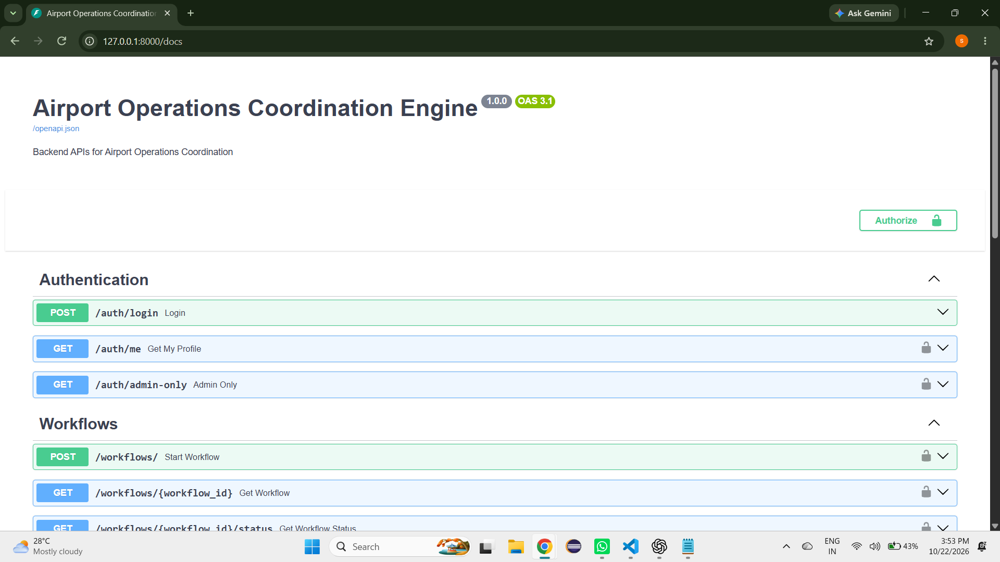
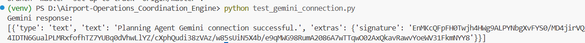
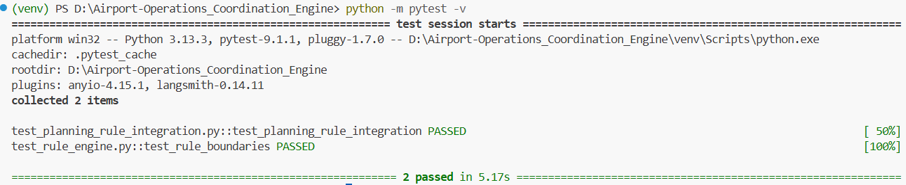
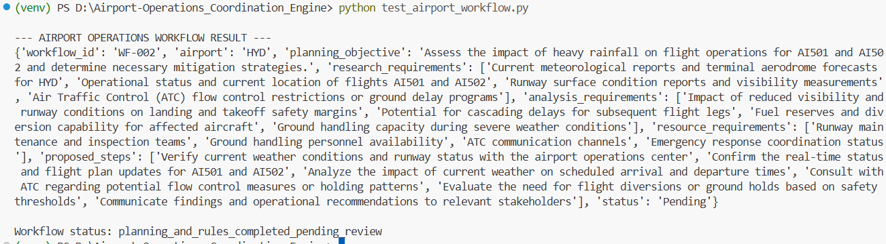

# Airport Operations Coordination Engine

## 1. Project Overview

The Airport Operations Coordination Engine is a software project designed to support airport operational coordination by processing disruption information, generating operational plans, evaluating predefined operational rules, and storing workflow results.

The project combines a Python backend, an AI-powered Planning Agent, a Rule Engine, and an SQLite database.

**Milestone 1 focuses on backend development, AI agent implementation, Rule Engine development, workflow integration, database persistence, and testing.**

## 2. Project Objectives

* Develop backend APIs for airport operational workflows.
* Implement authentication and authorization.
* Integrate Google Gemini for AI-based operational planning.
* Generate structured planning results.
* Evaluate operational inputs using predefined rules.
* Integrate the Planning Agent and Rule Engine into a workflow.
* Store and retrieve workflow results using SQLite.
* Maintain audit logs for relevant operations.
* Verify the implementation through automated tests.

## 3. Technology Stack

| Component               | Technology                 |
| ----------------------- | -------------------------- |
| Programming Language    | Python                     |
| Backend Framework       | FastAPI                    |
| ASGI Server             | Uvicorn                    |
| Data Validation         | Pydantic                   |
| Database                | SQLite                     |
| Authentication          | JWT                        |
| AI Model                | Google Gemini              |
| AI Integration          | LangChain                  |
| Workflow Orchestration  | LangGraph                  |
| Automated Testing       | Pytest                     |
| API Testing             | Swagger UI / OpenAPI       |
| Development Environment | Python Virtual Environment |

## 4. Project Architecture

The project contains the following main components:

1. **Backend API:** Handles requests, authentication, and workflow operations.
2. **Planning Agent:** Uses Google Gemini to generate structured operational plans.
3. **Rule Engine:** Evaluates operational inputs against predefined rules.
4. **Workflow Orchestration:** Connects the Planning Agent and Rule Engine.
5. **Database:** Stores workflow information and results.
6. **Testing:** Verifies the functionality of the implemented components.

## 5. Project Structure

The following is a representative structure. Adjust it to match the actual files in your repository.

```text
Airport-Operations_Coordination_Engine/
│
├── app/
│   ├── main.py
│   │
│   ├── api/
│   │   ├── auth.py
│   │   └── workflow.py
│   │
│   ├── agents/
│   │   ├── llm.py
│   │   ├── planning_agent.py
│   │   ├── schemas.py
│   │   └── workflow.py
│   │
│   ├── rule_engine/
│   │   ├── engine.py
│   │   ├── rules.py
│   │   └── ...
│   │
│   ├── schemas/
│   │   └── workflow.py
│   │
│   └── ...
│
├── data/
│   └── airport_operations.db
│
├── tests/
│   └── ...
│
├── .env
├── .gitignore
├── requirements.txt
└── README.md
```

## 6. Backend Development

The backend is developed using FastAPI.

### Implemented functionality

* API routing and request handling.
* JWT-based authentication.
* Password hashing and verification.
* Request validation using Pydantic.
* Workflow creation and retrieval.
* SQLite database connectivity.
* Audit logging.
* Persistence of planning and rule evaluation results.

The backend provides the foundation for integrating AI-based planning and operational rule evaluation.



## 7. AI Planning Agent

The Planning Agent is the first AI agent implemented in the project.

It uses Google Gemini through LangChain to generate structured planning results from the supplied airport disruption information.



### Main responsibilities

* Understand the supplied disruption description.
* Identify the planning objective.
* Define research requirements.
* Identify analysis requirements.
* Identify resource requirements.
* Propose operational investigation steps.
* Return structured planning results.

### Main implementation files

| File                           | Responsibility                          |
| ------------------------------ | --------------------------------------- |
| `app/agents/llm.py`            | Initializes the Gemini language model.  |
| `app/agents/planning_agent.py` | Implements Planning Agent logic.        |
| `app/agents/schemas.py`        | Defines the structured planning result. |
| `app/agents/workflow.py`       | Orchestrates the workflow.              |

The Planning Agent returns structured results that can be used by the workflow and reviewed by authorized personnel.

## 8. Rule Engine

The Rule Engine evaluates operational inputs using predefined rules.

### Initial operational checks

* Flight delay thresholds.
* Rainfall thresholds.
* Runway availability.

Additional rule-related components address areas such as permissions, weather, scheduling, and gate management.

### Main implementation files

| File                        | Responsibility                              |
| --------------------------- | ------------------------------------------- |
| `app/rule_engine/rules.py`  | Defines operational rules and thresholds.   |
| `app/rule_engine/engine.py` | Evaluates operational inputs against rules. |

The Rule Engine produces results that help identify operational conditions requiring attention.

**Note:** Rule evaluation is advisory and does not independently authorize operational decisions.



## 9. Workflow Integration

The workflow integrates the Planning Agent and Rule Engine.

### Workflow execution sequence

1. Receive airport disruption information.
2. Identify the airport and affected flights.
3. Invoke the Planning Agent.
4. Generate structured planning results.
5. Evaluate operational inputs using the Rule Engine.
6. Collect planning and rule evaluation results.
7. Update the workflow status.
8. Store the workflow results in SQLite.

An example workflow status observed during testing is:

`planning_and_rules_completed_pending_review`

This indicates that planning and rule evaluation have completed and the results remain pending review.

## 10. Database and Persistence

The project uses SQLite to store workflow information.

Database file used during development:

`data/airport_operations.db`

Workflow records can include:

* Workflow ID.
* Workflow type.
* Workflow status.
* Requesting user.
* Input data.
* Planning results.
* Rule evaluation results.

The workflow implementation has been tested for saving and retrieving planning and rule evaluation results.



## 11. Environment Setup

### Step 1: Open the Project Directory

Open PowerShell and run:

```powershell
cd D:\Airport-Operations_Coordination_Engine
```

### Step 2: Activate the Virtual Environment

```powershell
.\venv\Scripts\Activate.ps1
```

### Step 3: Install Dependencies

If `requirements.txt` contains the project's required packages, run:

```powershell
python -m pip install -r requirements.txt
```

### Step 4: Configure Google Gemini

Configure the `.env` file using the variable names expected by the application.

Example:

```env
GEMINI_MODEL=your_configured_gemini_model
GOOGLE_API_KEY=your_google_gemini_api_key
```

Replace the example values with your actual configuration.

**Security precautions:**

* Do not put your real API key in this README.
* Do not commit `.env` to a public repository.
* Ensure `.env` is included in `.gitignore`.

## 12. Running the Backend

Activate the virtual environment and run the following command from the project root:

```powershell
uvicorn app.main:app --reload
```

After the server starts, open Swagger UI:

`http://127.0.0.1:8000/docs`

Swagger UI provides the available API endpoints and allows requests to be tested interactively.

Authentication requirements depend on the endpoint being tested.

## 13. Testing the Workflow API

A representative request body used for workflow testing is:

```json
{
  "workflow_type": "airport_disruption",
  "input_data": {
    "airport": "HYD",
    "disruption": "Heavy rainfall affecting flight operations",
    "affected_flights": [
      "AI501",
      "AI502"
    ]
  }
}
```

Submit the request to the workflow creation endpoint shown in Swagger UI.

The exact endpoint path and authentication requirements should be confirmed from the running application.

The response is expected to provide workflow information and the results produced by the implemented workflow.

## 14. Verifying Database Persistence

To inspect recent workflow records, run the following command from the project root if your database module and table schema match these names:

```powershell
python -c "import json; from app.database.connection import get_db_connection; c=get_db_connection(); rows=c.execute('SELECT workflow_id,status,planning_result,rule_results FROM workflows ORDER BY id DESC LIMIT 3').fetchall(); [print(json.dumps(dict(r), indent=2)) for r in rows]; c.close()"
```

This command displays recent workflow IDs, statuses, planning results, and rule evaluation results.

If the database connection module or column names differ in your local implementation, adjust the query accordingly.

## 15. Running Automated Tests

Run the following command from the project root:

```powershell
python -m pytest -v
```

The test output shows which tests pass or fail.

The project tests were previously reported as passing during development. Run them again against the current code before presenting the final result to your mentor.

## 16. Security Considerations

* Store API keys in environment variables.
* Keep credentials out of source control.
* Protect endpoints that require authentication.
* Validate incoming request data.
* Avoid exposing sensitive information in logs.
* Review AI-generated results before using them for operational decisions.

## 17. Milestone 1 Verification Checklist

Use the following checklist to verify the milestone:

* [ ] Backend starts successfully.
* [ ] Required API endpoints are available in Swagger UI.
* [ ] Authentication works as expected.
* [ ] Google Gemini connection works.
* [ ] Planning Agent generates structured results.
* [ ] Rule Engine evaluates the configured operational inputs.
* [ ] Workflow integrates the Planning Agent and Rule Engine.
* [ ] Planning and rule results are saved in SQLite.
* [ ] Saved workflow results can be retrieved.
* [ ] Automated tests pass.
* [ ] README accurately reflects the implementation.
* [ ] All mentor-defined Milestone 1 requirements are satisfied.

## 18. Current Scope and Limitations

Milestone 1 establishes the initial backend and AI workflow foundation.

The implemented workflow may use predefined or test values for rainfall, flight delays, and runway availability. These values must not be described as live operational data unless a live data integration has been implemented and verified.

Similarly, live flight tracking, live weather integration, production deployment, and autonomous operational control should only be claimed as completed if they have actually been implemented and tested.

## 19. Conclusion

Milestone 1 establishes the initial foundation of the Airport Operations Coordination Engine by combining backend API development, AI-based operational planning, predefined rule evaluation, workflow orchestration, and database persistence.

The implementation provides a basis for future development while allowing the current workflow and its outputs to be tested and reviewed.

**Final Milestone 1 completion should be confirmed against the project requirements agreed upon with the mentor.**
